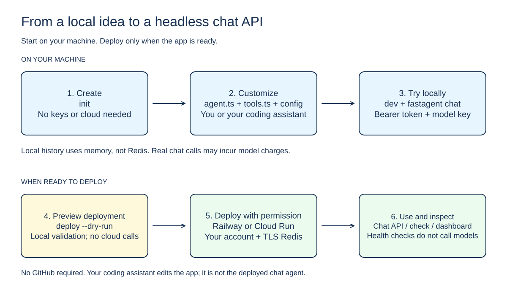

# Fastagent

Create a headless chat agent locally, then deploy it to your own Railway or Google Cloud Run account. Get an HTTPS URL where a client can send messages with a bearer token.

Fastagent provides the project template, the headless HTTP API, deployment commands, and a small terminal dashboard. You write the prompt and tools yourself, or ask Claude Code or Codex to help.

**No GitHub repository is required.** The deployed app is a chat agent, not a coding agent or sandbox. It uses the official OpenAI SDK for OpenRouter or direct OpenAI.



[Edit this diagram in Excalidraw](docs/diagrams/workflow.excalidraw) · [How to edit the diagrams](docs/diagrams/README.md)

## Build with your coding agent

Paste this into Claude Code, Codex, or another coding agent. Replace the bracketed description with your idea:

```text
Help me build a headless chat agent using Fastagent.

Agent idea: [Describe who it helps, what it should do, and any APIs it needs.]

Build the CLI from source: clone https://github.com/trycedar0x/fastagent,
run npm ci and npm run build, then use node dist/cli.js for every command.
Alternatively, install @0xtryeva/fastagent@0.2.0 with npm and use fastagent.
Version 0.1.0 is the older password-protected release.
Create the app in a new directory; never overwrite existing files.

Read AGENTS.md, docs/user-guide.md, and .agents/skills/fastagent/SKILL.md
in that checkout.
Ask me about any missing requirements, then create a separate app with
Fastagent's OpenAI template. Read the app instructions and the
fastagent-app skill before editing its prompt or tools.

The app is headless: one bearer token authorizes every conversation for
the app, and there is no browser password UI. `init` generates a random
FASTAGENT_API_TOKEN into an ignored .env.auth file; put the model key
selected by fastagent.yaml in an ignored .env file. Never ask me to paste
secrets into chat, print them, or commit them. Do not add shell-execution
tools. Build and run the app locally so I can try it with
the CLI's `chat` command. Ask before making paid model calls yourself.

Once the local app works, ask whether I want Railway or Cloud Run deployment.
Explain the account, billing, authentication, and TLS Redis (or single-instance ephemeral history) requirements.
Start with deploy --dry-run. Wait for my explicit approval before real
deployment, interactive cloud login, or deleting resources. Report what
was actually verified; a dry run or health check does not prove chat works.
```

## Start here

**Version 0.2.0:** `@0xtryeva/fastagent` provides the headless bearer-token CLI described here. Version 0.1.0 generated the earlier password-protected app. The unscoped `fastagent` npm package is a different, unrelated project.

You need Node.js 22+ and npm. Install the CLI and create an app:

```sh
npm install -g @0xtryeva/fastagent@0.2.0
fastagent init ./my-agent --framework openai
```

This creates a new app in `my-agent/`; existing directories are never overwritten.

In the generated app:

```sh
cd my-agent
npm install
```

`init` has already written an ignored, owner-only `.env.auth` with a random bearer token (32 random bytes, base64url), so you only need an ignored `.env` with the model key selected by `fastagent.yaml`. The default model is `openrouter/deepseek/deepseek-v4.1-flash`, which requires `OPENROUTER_API_KEY`; an `openai/<model>` reference requires `OPENAI_API_KEY` instead. Never print, commit, or paste the token.

Run from the app directory:

```sh
fastagent dev
```

The [user guide](docs/user-guide.md) uses source-based invocation. With the npm installation above, use `fastagent` instead of `node /path/to/fastagent/dist/cli.js`.

`dev` builds and starts the headless server on explicit localhost HTTP. It does not serve a browser UI. Local development uses memory history and needs no Redis. Send a message with the headless client:

```sh
fastagent chat --url http://127.0.0.1:3000 --env-file .env.auth --message "Hello"
```

The bearer token is read only from the explicit `--env-file`, never from a command argument or the inherited shell. Real chats use your API key and may cost money. Do not expose the local HTTP port to the internet.

Starting the agent requires the matching model API key: `OPENROUTER_API_KEY` for the default OpenRouter model, or `OPENAI_API_KEY` for direct OpenAI. Put it in the app's ignored `.env`; a missing or blank key prevents startup with an actionable error. Local models are not supported. Scaffolding and builds remain credential-free.

## Choose a model

`fastagent models` reads the public OpenRouter catalog and prints estimates with a fetch timestamp, source URL, tool support, and unknown prices marked as unknown. These are base token prices: cache-read prices and context-length overrides are not shown, and the price you pay depends on which provider serves the request. It makes no generation call and needs no key.

```sh
node /path/to/fastagent/dist/cli.js models --search deepseek-v4.1-flash --json
```

The owner selects the model through `fastagent.yaml` only; there is no visitor model picker. Model context stays independently bounded regardless of conversation length.

## Build from source instead

In a new checkout:

```sh
git clone https://github.com/trycedar0x/fastagent.git
cd fastagent
npm ci
npm run build
node dist/cli.js --help
```

This does not install a global command. Use the absolute path to `dist/cli.js` from an app directory, or follow the [source-based user guide](docs/user-guide.md).

## Deploy

For deployment you also need:

- Your own Railway or Cloud Run account, billing, and the provider's CLI.
- A TLS Redis URL, unless you opt into `FASTAGENT_EPHEMERAL_HISTORY=1` single-instance in-memory history. You supply and pay for Redis; Fastagent does not create it.
- For Cloud Run, two existing, different service accounts: one for the app and one for builds.

**Why Redis?** In production it stores conversation history, not login sessions. There is no per-visitor login; the bearer token authorizes every conversation for the app. Shared Redis lets all deployed instances read and commit the same history and keeps it available after a restart. In-memory history would disappear on restart and would not be shared between instances.

Redis is required in production unless you explicitly opt into single-instance in-memory history with `FASTAGENT_EPHEMERAL_HISTORY=1`. Local `dev` uses memory. You provide your own TLS-enabled Redis; Fastagent does not provision it. If Redis is unavailable, the app fails closed with 503 responses and never falls back to memory. Ephemeral mode is only safe when the deployment pins exactly one instance: Cloud Run is capped at one instance and Railway is pinned to one replica, and the app prints a startup warning that history is lost on restart. Set a TLS `REDIS_URL` or `FASTAGENT_EPHEMERAL_HISTORY=1`, never both and never neither.

Put the model key and, for production, either `REDIS_URL` or `FASTAGENT_EPHEMERAL_HISTORY=1` in the app's ignored `.env`. Keep `FASTAGENT_API_TOKEN` in the generated `.env.auth`; do not copy it into `.env` or a command argument. When you omit `--env-file`, deploy auto-detects the ignored `.env` and then `.env.auth` in the app directory (never `.env.example`, never a shell variable).

Deployment commands run **inside the app directory**. Use `fastagent` if installed from npm, or the absolute path to the built `dist/cli.js` when using a source checkout.

Start with `deploy --dry-run`. It checks local inputs without contacting the cloud. Removing `--dry-run` can create billable resources.

See the [user guide](docs/user-guide.md) for complete Railway and Cloud Run commands. Leave `APP_ORIGIN` unset on the first deploy; the CLI sets it from the provider URL.

Existing apps created by the earlier password-protected release can still be deployed where safely possible; a generated token-access app is never silently rewritten into an old one.

## Commands

| Command | Purpose |
| --- | --- |
| `init` | Create a new app from the local template |
| `dev` | Build and run an app on localhost |
| `models` | Read the public OpenRouter catalog (metadata only) |
| `chat` | Send one headless message using an explicit token file |
| `login` | Show Railway token instructions or start explicit Cloud Run login |
| `deploy` | Create or update a recorded deployment |
| `status` / `logs` | Inspect a deployment without blocking on mutation locks |
| `recover` | Read-only interruption diagnostics and manual recovery next steps |
| `check` | Check its HTTP health endpoint, without calling a model |
| `dashboard` | View locally recorded deployments in a terminal |
| `destroy` | Delete verified app-owned resources, with `--yes` |

Run `node dist/cli.js --help` for exact arguments. Most commands support `--json`. `dev`, interactive login, and the interactive dashboard do not; `dashboard --json` returns an offline snapshot.

## Current limits

- One model adapter: the official OpenAI SDK, aimed at OpenRouter or direct OpenAI. Deployment backends: Railway and Cloud Run.
- Bearer-token access is required. Redis stores conversation history in production, not login sessions; the only alternative is the explicit single-instance `FASTAGENT_EPHEMERAL_HISTORY=1` in-memory mode, which loses history on restart.
- Bounded history (7-day sliding expiry, 1000 conversations per app, 40 messages and 256 KiB per conversation) and bounded model context (20 messages, 16,000 characters).
- No browser UI, per-visitor identity, long-term memory, coding tools, sandbox, or automatic GitHub deployment.
- `check --chat` is not supported. Test chat with the CLI's `chat` command, which makes a real billable request.
- Cloud Run logs show metadata, not application message bodies.
- Deleting an app may leave shared resources and costs behind.
- There is no native iMessage integration. A separate Mac-side bridge can call this API, and cloud hosts cannot access Apple Messages.

Local tests and mocked cloud tests pass. A fresh npm installation has been checked, including creating an app with the installed CLI. **Live cloud deployment, real Redis/Lua, Docker, browser behavior, and Windows still need verification.** Mock tests are not proof of a successful cloud deployment.


## For coding assistants

Before using the CLI, read [the CLI skill](.agents/skills/fastagent/SKILL.md). Before editing an app, read [the app skill](.agents/skills/fastagent-app/SKILL.md). Before changing Fastagent itself, read [AGENTS.md](AGENTS.md) and [the architecture](docs/architecture.md).

Use `--json` where available. Never print secrets. Do not run a billable deployment, destructive command, interactive login, or paid model call without the user's permission. A dry run does not prove cloud permissions or readiness.

## License

[Apache License 2.0](LICENSE).
