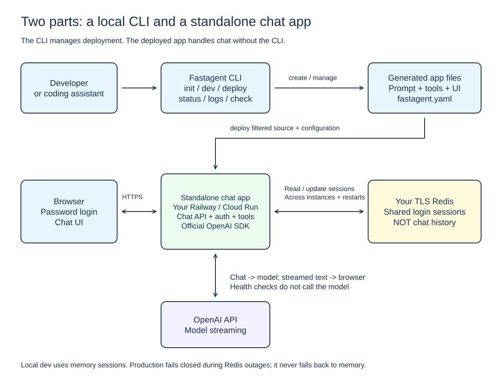

# Architecture

Fastagent has two parts: a local CLI and a generated headless chat app. The CLI deploys the app to user-owned Railway or Cloud Run accounts. There is no Fastagent-hosted control plane or billing system.

## System overview

[Editable Excalidraw source](diagrams/architecture.excalidraw)

The generated app can build and run without the CLI package. It serves the chat API directly and connects to a user-supplied TLS Redis for production history; local development may use in-memory history instead, and the app never runs a history store of its own. It has no browser UI. GitHub is not required.

## Code layout

| Path | Responsibility |
| --- | --- |
| `src/cli.ts` | Arguments, output, and exit codes |
| `src/config/` | Validate project configuration |
| `src/scaffold/` | Render the local template; create files without overwriting |
| `src/dev/` | Build and start localhost development |
| `src/models/` | Public OpenRouter catalog metadata and model reference grammar |
| `src/chat/` | Headless chat client used by `fastagent chat` |
| `src/deployment/` | Secrets, child processes, source staging, Dockerfiles, local state, and lifecycle commands |
| `src/deployment/providers/` | Railway and Cloud Run adapters |
| `src/checks/` | Saved-target selection and HTTP health checks |
| `src/dashboard/` | Terminal display and user actions |
| `templates/openai/` | Standalone app source, Dockerfile, and setup instructions |

Use TypeScript, Node.js 22+, npm, and ESM. The only model adapter is the official OpenAI SDK, aimed at OpenRouter or direct OpenAI; do not add Vercel AI SDK, Next.js, or another platform without a separate decision. The product default model is `openrouter/deepseek/deepseek-v4.1-flash`. Prices shown by `fastagent models` are live catalog estimates, never hardcoded.

Keep the CLI thin. Business logic belongs in app `src/agent.ts` and `src/tools.ts`, not in deployment or transport code.

## Project configuration and local state

`fastagent.yaml` has a strict, versioned schema: app name, `framework: openai`, model identifier, and `deployment.access`. Unknown fields, duplicate keys, and unsupported YAML aliases are rejected, and the file contains no secrets. The schema accepts exactly two variants. New apps are always generated with `access: token`. `access: protected` is accepted for apps generated by the earlier password-protected release so they remain deployable; it is never produced for a new app, and an existing protected app is never silently rewritten into a token app. The app runtime shipped in this repository implements the token variant only, because a legacy protected app keeps the source it was generated with.

Deployment records are private local files, normally under `~/.fastagent/deployments`. A record identifies the canonical app path, provider, target, resource IDs, random ownership marker, history namespace, URL, and last known status.

State writes are atomic and locked. Save confirmed IDs before the next cloud operation. Do not steal stale locks automatically or assume that a timed-out mutation did nothing.

Resource names alone do not prove ownership. Adapters verify remote IDs and ownership markers before updating or deleting resources.

## App runtime

New apps are headless and serve these endpoints under one bearer token. A legacy `access: protected` app instead keeps the runtime it was generated with: it serves its browser login and scrypt-protected session endpoints, and its requests are authorized by a password hash and session cookies rather than a bearer token. The CLI derives the required secrets and the runtime namespace from `deployment.access`, so deploying an existing protected app keeps its password configuration, its `FASTAGENT_PASSWORD_HASH`, its `OPENAI_API_KEY`, and its `FASTAGENT_SESSION_NAMESPACE`, and never converts it to token access. The endpoint table below therefore describes a newly generated app:

| Endpoint | Purpose |
| --- | --- |
| `GET /healthz` | App and history-store readiness; no model call |
| `POST /api/chat` | Stream an authenticated, bounded chat response as NDJSON |
| `GET /api/conversations/:id` | Return stored messages, or 404 |
| `DELETE /api/conversations/:id` | Delete stored history, or 404; 409 while a generation lease is active |

All three `/api/*` endpoints require `Authorization: Bearer <FASTAGENT_API_TOKEN>`; only `GET /healthz` is unauthenticated.

Chat accepts one bounded user message and an optional server-issued conversation ID. The server owns conversation context; clients cannot supply roles, system prompts, a model, or history. Unknown supplied IDs return 404 before any model work.

Responses use newline-delimited JSON: a `conversation` frame, then `delta` frames, then `done` or an error frame. Tools run on the server. Disconnects and shutdown cancel model work where supported. Empty, whitespace-only, and reasoning-only completions are generic failures; reasoning content never enters a reply or stored history.

Production listens on `0.0.0.0` and the platform's `PORT`. Explicit local development uses IPv4 loopback HTTP.

## Authentication and history

One bearer token authorizes every conversation for the app. There is no per-visitor identity, cookie, CSRF token, or browser password UI. Requests must present exactly one `Authorization: Bearer` field; query tokens, cookies, and duplicate credential fields are rejected. If a client sends `Origin`, it must match `APP_ORIGIN` exactly; machine clients may omit it.

Production uses user-supplied TLS Redis, which stores conversation history rather than login sessions. A completed turn is stored for seven days from the successful commit. An app holds at most 1000 conversations; a new conversation is rejected at capacity. A conversation holds at most 40 messages and 256 KiB of serialized UTF-8, trimming oldest whole turns. A generation lease lasts 45 seconds against the 30-second request limit. Commit, release, and delete check lease ownership atomically. A failed or aborted request stores no turn, does not extend retention, and releases its reservation: an aborted request never starts a commit. A commit that has already started is atomic and uncancellable, and a successful commit ends lease ownership, so an abort landing in that sub-atomic window can still store the completed turn; the response then reports the committed turn rather than claiming a failure for stored history. Closing that window would require an atomic rollback operation that restores the previous messages and their original expiry. Missing or expired reads and deletes return 404, an active delete returns 409, and capacity exhaustion returns 429.

Model context is independently bounded, regardless of stored history: the complete request sent to the model is at most 20 messages and 16,000 characters including the system prompt and tool turns. Older whole turns are dropped to fit, and a request that cannot fit fails generically without calling the model.

Local development may use memory. Production never falls back to memory during a Redis outage. Startup and store requests are bounded; outages return generic 503 errors and native reconnect restores service.

All versions of an app share its namespace. Different apps must use different namespaces. Changing the bearer token does not revoke stored history; use a different namespace to isolate a different app, and keep the namespace stable across versions.

## Limits and abuse protection

Input, output, concurrency, tool steps, and time are bounded in the app, independently of the bearer-token model. A request body is limited to 32 KiB; an instance serves at most four concurrent chats; each chat is limited to 30 seconds, three model/tool steps, up to 1,024 output tokens per step, and 64 KiB of streamed text. Stored history and model context have their own bounds described above, and the 20-message and 16,000-character model bound covers the complete request including the system prompt and tool turns. Health and dashboard polling never call a model.

These are per-instance throttles, not a distributed abuse-protection layer or hard spending caps. They may group clients behind a proxy, and cancellation may not prevent every provider charge.

## Secret boundaries

For a newly generated app, runtime secrets are the bearer token (`FASTAGENT_API_TOKEN`), the model key selected by the model reference (`OPENROUTER_API_KEY` or `OPENAI_API_KEY`), and the Redis URL. A legacy `access: protected` app instead uses the password hash (`FASTAGENT_PASSWORD_HASH`) and its session namespace (`FASTAGENT_SESSION_NAMESPACE`) plus the OpenAI key, and it needs no bearer token. The CLI selects the required key set from `deployment.access`, so a protected app keeps its existing password secrets. It reads only explicitly selected secret files. Do not put values in command arguments, configuration, state, logs, uploads, images, or client code.

Builds must work without model or Redis credentials. The upload uses an allowlisted temporary directory, rejects symlinks, and excludes environment files and common credential paths. Deployment currently accepts only the bundled Dockerfile.

This does not detect arbitrary secrets embedded in trusted source code.

Cloud Run injects Secret Manager references at runtime. Railway exposes variables to its build infrastructure too; the bundled Dockerfile must not consume secret build arguments. Do not claim provider-level runtime-only isolation on Railway.

## Deployment flow

1. Validate local configuration, explicit secrets, and provider inputs.
2. Stage only allowed source files.
3. Lock the selected target and save stable ownership and history-namespace information.
4. Verify or create provider resources, recording each confirmed identity.
5. Obtain an HTTPS origin. Validate it before making chat accessible.
6. Configure runtime settings and upload the app.
7. Wait for the exact deployment/revision to become ready and pass health checks.
8. Save the result, release the lock, and remove temporary staging files.

A queued build is not a successful deployment. Unknown mutation outcomes require reconciliation, not blind retries. `--dry-run` stops at local validation; it makes no cloud calls.

### Railway

Use the official CLI for creation, variables via stdin, source upload, deployment polling, and logs. A bounded API transport handles ownership/configuration/deletion where needed.

Acquire the domain before app activation. Account credentials are required for initial creation and deletion; environment-scoped tokens only reuse recorded targets. Delete the verified service, never the whole project.

### Cloud Run

Use `gcloud` with an explicit project, region, and existing runtime/build service accounts. They must differ. Detect prerequisites; do not automatically enable billing or grant broad project roles.

Create app-owned secrets, pin confirmed versions, and grant the runtime account access. Keep the initial deployment private until its real HTTPS origin is verified. Route traffic to one selected revision without tags or traffic splits.

Instance caps are cost defaults, not strict singleton guarantees. Shared Redis makes history work across rollout overlap. IAM diagnostics are not complete proof of effective inherited/custom-role permissions.

Deletion verifies the service and owned secrets. Projects, accounts, shared registries, images, and build history may remain.

## Health and dashboard

Health and deployment status are separate. `check` requests bounded HTTPS `/healthz` without redirects or model calls. It does not test API keys or tools. `check --chat` is unsupported; `fastagent chat` is the explicit, billable chat test.

The dashboard reads local records and polls health. Cloud status/log actions require explicit matching provider settings and authentication. Its default status is cached. JSON snapshots are offline.

## Development and validation

Add focused offline tests for configuration, file safety, secrets, state recovery, provider command construction, auth, streaming, history bounds, catalog parsing, and terminal cleanup.

Run `npm run typecheck`, `npm run build`, and `npm test`. Also build a generated app. Use injected models and cloud transports; do not use real credentials or paid calls in tests. `fastagent models` is metadata-only and makes no generation call.

Live cloud, real Redis/Lua, Docker, fresh registry installation, and Windows checks are separate gates. Mock tests do not certify production behavior.

Delegate only when authorized. Keep one writer per checkout; separate component work with explicit handoffs. Do not commit, publish, or provision resources without permission.

## Out of scope

Coding agents, arbitrary code execution, sandboxes, per-visitor identity, long-term memory beyond the bounded history, multi-agent orchestration, billing, GitHub autodeploy, native iMessage integration, and additional model adapters are not part of this version. A separate Mac-side bridge may call the deployed API; cloud hosts cannot access Apple Messages.
