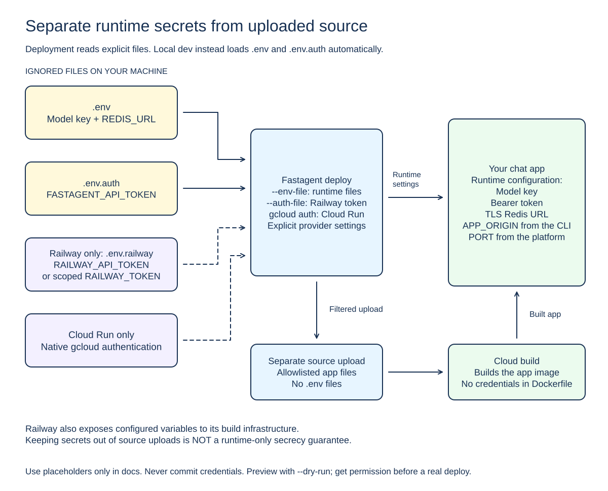

# User guide

This guide takes you from a local project to a headless chat API. The app uses the official OpenAI SDK for OpenRouter or direct OpenAI and runs in your own cloud account.

Fastagent creates the starting code. You or your coding assistant write the prompt and tools. The CLI does not use a model to generate your business logic.


[Editable Excalidraw source](diagrams/workflow.excalidraw)

## 1. Build the CLI

You need Node.js 22+ and npm. In the Fastagent repository:

```sh
npm ci
npm run build
node dist/cli.js --help
```

These commands build the CLI; they do not install it globally. This guide uses `node dist/cli.js` from the repository, and `node /path/to/fastagent/dist/cli.js` from an app directory. Replace that placeholder with the actual absolute path.

If `fastagent` is already on your PATH, you can use it instead.

## 2. Create an app

In the Fastagent repository:

```sh
node dist/cli.js init ./my-agent --name my-agent --framework openai
```

The target directory must not exist, and its parent must exist. Names use lowercase letters, digits, and hyphens, up to 63 characters. Existing files are never overwritten.

You do not need an API key, GitHub, Redis, Docker, or a cloud account for this step.

The app includes:

- `src/agent.ts`: prompt and OpenAI model adapter.
- `src/tools.ts`: predefined tools; the example converts temperatures.
- `src/server.ts`: headless HTTP server, bearer auth, streaming chat, and conversation history.
- `fastagent.yaml`, package files, and a Dockerfile.
- README, contributor instructions, and an ignored, owner-only `.env.auth` containing a random bearer token already generated by `init`.

There is no browser UI. A newly generated app uses token access and does not serve `/api/login` or any browser password page.

Edit the app yourself or ask Claude Code or Codex:

> Make this a weather assistant using my weather API. Keep bearer auth, health checks, and deployment working.

Your coding assistant operates the local CLI. It is not the agent running in the deployed app.

## 3. Run locally

In the generated app directory:

```sh
cd my-agent
npm install
```

`init` already generated an ignored `.env.auth` with a random `FASTAGENT_API_TOKEN`, so you only need an ignored `.env` with the model key selected by `fastagent.yaml`:

```sh
# .env
OPENROUTER_API_KEY=<your OpenRouter key>
```

The default model is `openrouter/deepseek/deepseek-v4.1-flash`, which uses `OPENROUTER_API_KEY`. An `openai/<model>` reference uses `OPENAI_API_KEY` instead. Do not set both. Keep every secret file ignored; do not commit, paste into logs, or pass keys as command arguments. Regenerate the token yourself only if you replaced the file: use at least 32 random bytes encoded as base64url.

Back in the Fastagent repository:

```sh
node dist/cli.js dev ./my-agent
```

`dev` builds the app and starts the headless server on explicit localhost HTTP. Stop with Ctrl-C.

- Local development uses memory history; Redis is not required.
- Real chats can incur model charges.
- There is no hot reload. Restart after changes.
- `--install` explicitly allows the CLI to install app dependencies.
- Local HTTP binds to IPv4 loopback. Do not expose or tunnel it.

Send a message with the headless client. The token is read only from the explicit `--env-file`, never from an argument or the inherited shell:

```sh
node dist/cli.js chat --url http://127.0.0.1:3000 --env-file ./my-agent/.env.auth --message "Hello"
```

`chat` accepts `--message` or reads stdin, supports `--conversation <id>` to resume a server-assigned conversation, and `--json` for one machine-readable result. The URL must be HTTPS or explicit localhost HTTP. The client refuses credential-bearing redirects so the token is not sent to another origin. It bounds response size and total time.

The agent will not start without the matching model key in `.env`: `OPENROUTER_API_KEY` for OpenRouter, or `OPENAI_API_KEY` for direct OpenAI. Missing, empty, or whitespace-only keys fail before readiness; `dev --json` reports `MODEL_API_KEY_MISSING`. Local models are not supported. Startup checks key presence only, not provider validity, and never calls a model.

## 4. Choose a model

`fastagent models` reads the public OpenRouter catalog. It needs no key and makes no generation call, so it never incurs model charges:

```sh
node dist/cli.js models --search deepseek --limit 10 --json
```

Output includes an estimate in USD per million tokens, a fetch timestamp, a source URL, and tool support. Unknown prices stay `null` (unknown) rather than a fabricated number. Documented tilde-prefixed vendor aliases such as `~deepseek/deepseek-flash-latest` are accepted. The owner selects the model in `fastagent.yaml`; visitors cannot choose a model.

## 5. Prepare for deployment

You need your own cloud account, billing, and provider CLI, plus either a TLS Redis service or the single-instance `FASTAGENT_EPHEMERAL_HISTORY=1` opt-in. Fastagent does not create Redis, enable billing, or set up all cloud permissions.

Use two runtime secret files in the app directory, plus a separate authentication file if you deploy to Railway:

| File | Contents |
| --- | --- |
| `.env` | The model key selected by `fastagent.yaml` (`OPENROUTER_API_KEY` or `OPENAI_API_KEY`) and one history backend: TLS `REDIS_URL` **or** `FASTAGENT_EPHEMERAL_HISTORY=1` |
| `.env.auth` | `FASTAGENT_API_TOKEN` (generated by `init`) |
| `.env.railway` | Railway token, only when using Railway |

Use a `rediss://` Redis URL, or `FASTAGENT_EPHEMERAL_HISTORY=1` for single-instance in-memory history. Set exactly one, never both. Keep every secret file ignored. Omit empty optional assignments and do not use `.env.example` as a secret file.

You no longer have to retype the paths: when `--env-file` is omitted, deploy auto-detects the ignored `.env` and then `.env.auth` in the app directory. It never reads `.env.example`, never recurses, and never reads the shell; an explicit `--env-file` still wins. The CLI does not inherit runtime secrets or Railway tokens from your shell.

`FASTAGENT_EPHEMERAL_HISTORY=1` keeps history in memory. Enable it only when the deployment pins exactly one instance: Fastagent deploys Cloud Run with `--max-instances=1` (each revision at most one instance) and pins Railway to one replica. Treat this as disposable history: a Cloud Run rollout can briefly overlap the old and new revisions, so two processes may each hold separate memory for that window. The app refuses to start if both Redis and ephemeral mode are set, and in production if neither is set. It prints a startup warning and history is lost on every restart; machine clients are unaffected and `GET /healthz` still works.

Leave `APP_ORIGIN` unset on the first deploy. Fastagent sets it to the exact provider HTTPS origin before opening chat access. If supplied for an update, it must match the recorded URL exactly: no path, trailing slash, query, or credentials.



[Editable Excalidraw source](diagrams/deployment.excalidraw). Solid arrows show runtime configuration and source flow; dashed arrows show the provider-specific authentication options.

## 6. Deploy to Railway

Install the Railway CLI and prepare your workspace ID. Store an account/workspace API token as `RAILWAY_API_TOKEN` in ignored `.env.railway`.

Run these commands **from the app directory**:

```sh
node /path/to/fastagent/dist/cli.js login --provider railway

node /path/to/fastagent/dist/cli.js deploy \
  --provider railway --workspace WORKSPACE_ID \
  --auth-file .env.railway \
  --dry-run
```

With `--env-file` omitted, deploy auto-detects `.env` and `.env.auth`. Add `--env-file .env --env-file .env.auth` to override. `--auth-file` is always explicit.

Railway `login` prints token instructions; it does not authenticate you or confirm that the token works.

Review the dry-run output. Remove `--dry-run` to create or update the actual cloud app. This may incur charges.

An environment-scoped `RAILWAY_TOKEN` entry in the explicit `--auth-file` only works for an already recorded target, with `--railway-project` and `--railway-environment`. Both token types are read from the file, not from exported shell variables. First deployment and deletion require an account token.

Railway provides variables to its build infrastructure as well as the runtime. The bundled Dockerfile does not consume secret build arguments, and upload filtering excludes local secret files. This is not a promise that the platform's build infrastructure never receives the variables.

## 7. Deploy to Cloud Run

Install `gcloud`. Prepare your project, billing, required APIs and permissions, and two existing, distinct service accounts: runtime and build.

Run these commands **from the app directory**:

```sh
node /path/to/fastagent/dist/cli.js login \
  --provider cloudrun --interactive

node /path/to/fastagent/dist/cli.js deploy \
  --provider cloudrun --project PROJECT_ID --region REGION \
  --runtime-account RUNTIME_EMAIL --build-account BUILD_EMAIL \
  --dry-run
```

With `--env-file` omitted, deploy auto-detects `.env` and `.env.auth`.

Interactive login opens the native gcloud login flow and requires a terminal. It does not support `--json`.

Review the dry run, then remove `--dry-run` when you want to deploy. Fastagent uses Secret Manager for app secrets. It grants the runtime account access to app-owned secrets and allows public invocation of the service. It does not automatically grant broad project roles. Chat itself still requires the bearer token.

## 8. Update, inspect, or delete

Deployment commands use the current app directory. `--target` defaults to the app name in `fastagent.yaml`.

Repeat `deploy` with the same provider and target to update the recorded deployment. If an earlier mutation had an unknown result, the CLI may stop for manual reconciliation rather than risk duplicate resources.

For `status`, `logs`, and `destroy`, use the same provider flags and authentication as deployment, but omit the runtime `--env-file` flags.

```sh
# Example: inspect a Railway deployment
node /path/to/fastagent/dist/cli.js status \
  --provider railway --workspace WORKSPACE_ID \
  --auth-file .env.railway --json
```

Deletion requires `destroy ... --yes`. It only deletes resources whose ownership can be verified. Projects, shared resources, images, and build history may remain and continue costing money.

Cloud Run logs show timestamps and severity only. Application payloads are withheld because they may contain secrets.

## 9. Check health and use the dashboard

From the app directory:

```sh
node /path/to/fastagent/dist/cli.js check --provider railway --json
node /path/to/fastagent/dist/cli.js dashboard
node /path/to/fastagent/dist/cli.js dashboard --json
```

`check` requests HTTPS `/healthz`, does not follow redirects, and times out after five seconds. If both providers are recorded, choose `--provider`.

The dashboard only lists deployments saved on this machine. It does not discover all apps in your cloud accounts.

| Key | Action |
| --- | --- |
| ↑ / ↓ | Select a deployment |
| Enter | Open its chat URL |
| R | Refresh health; query selected cloud status when matching provider flags/authentication are supplied |
| L | Show logs when matching provider flags/authentication are supplied |
| Q | Quit |

The interactive dashboard needs a terminal. `dashboard --json` returns cached local records without network requests. Automatic polling checks health only, never the model or cloud status API.

These checks mean different things:

- **Deployment status**: the cloud platform's deployment result, queried by `status`. The dashboard initially shows the cached value.
- **Health**: whether the app and its history service respond.
- **Chat capability**: whether the model key, model, and tools actually work. Test this with `fastagent chat`, which makes a real billable request.

`check --chat` is not implemented. It exits before reading secrets or calling a model.

## History, tokens, and limits

Redis stores conversation history, not login sessions. One bearer token authorizes every conversation for the app; there is no per-visitor identity, cookie, or CSRF login. If a browser sends `Origin`, it must match `APP_ORIGIN` exactly. Machine clients may omit `Origin`.

A completed turn is stored for seven days from the successful commit. A failed or aborted request stores no turn and does not extend retention; a commit already in flight when a request is aborted can still store that completed turn and is then reported as committed rather than as a failure. A conversation holds at most 40 messages and 256 KiB of serialized UTF-8, trimming oldest whole turns. New conversations are rejected once an app reaches 1000 stored conversations. A generation lease lasts 45 seconds. Missing or expired reads and deletes return 404; deleting a conversation with an active generation returns 409; capacity exhaustion returns 429.

Redis outages return safe 503 responses and never fall back to memory. Native reconnect restores requests. Changing the token does not delete stored history; use a different history namespace for a different app and keep it stable across versions. In `FASTAGENT_EPHEMERAL_HISTORY=1` mode there is no Redis: history lives only in the single instance's memory and is lost on restart, so treat it as disposable.

Limits and per-instance throttles reduce abuse but are not hard spending caps. Treat your app code as trusted: upload filtering cannot find every secret embedded in source.

There is no native iMessage integration. A separate Mac-side bridge can call this API over HTTPS with the bearer token; cloud hosts cannot access Apple Messages.

## What has been verified

Local tests, mocked cloud orchestration, generated app builds, packaging smoke tests, and terminal cleanup have been exercised. A `fastagent models` lookup against the live public OpenRouter catalog has been run.

Live cloud deployment, real Redis/Lua, Docker, fresh registry installation, and Windows behavior still need verification. `--dry-run` checks local inputs only; it does not prove cloud permissions, model availability, or production readiness.

GitHub is optional. Importing existing agents, GitHub templates, and push-to-deploy are not part of this version.
